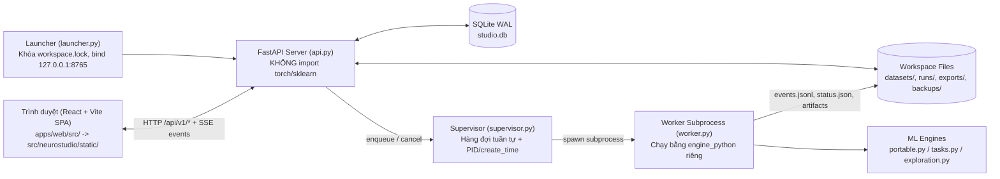
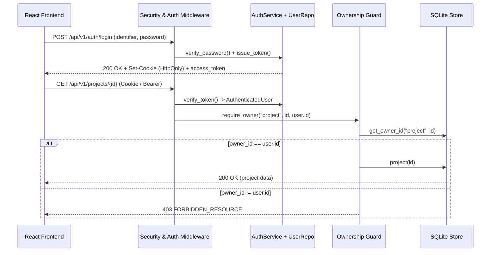

# Neuro Studio — Kiến trúc hệ thống & Thiết kế Multi-user

> Tài liệu mô tả kiến trúc hiện tại của Neuro Studio (`0.0.1b1`) và phương án mở rộng cho hệ thống tài khoản, phân quyền và cách ly dữ liệu trong đợt phát triển T2–T5.

---

## 1. Tổng quan kiến trúc hiện tại

Neuro Studio được thiết kế theo mô hình **tách biệt tầng điều phối nhẹ (API Server)** và **tầng thực thi ML nặng (Worker Subprocess)**.



### 1.1. Frontend (`apps/web/`)
- **Công nghệ:** React `19.1`, TypeScript `5.8`, Vite `6.3`, `@xyflow/react` (trình dựng graph kéo-thả), `recharts` (biểu đồ huấn luyện/đánh giá), `lucide-react`.
- **Cấu trúc trang chính trong `apps/web/src/main.tsx`:**
  - `home`: Dự án của tôi, Demo Gallery, nhập CSV/ZIP/SplitImport, thùng rác dự án.
  - `studio` (5 Labs): `Data Lab` → `Model Lab` (`GraphEditor.tsx`) → `Training Lab` (`TrainingSettings.tsx`, `StudyPanel.tsx`) → `Evaluation Lab` (`RegressionEvaluation.tsx`) → `Export Lab`.
  - `tasks`: `TaskStudio.tsx` (8 bài toán có giám sát).
  - `exploration`: `ExplorationStudio.tsx` (Clustering + PCA/t-SNE/UMAP).
  - `learn`: `LearningStudio.tsx` (12 bài học từ `curriculum.json`).
  - `setup`, `monitor`, `guide`, `about`: Cấu hình môi trường Python/GPU (`HardwarePanel.tsx`, `MaintenancePanel.tsx`), theo dõi tài nguyên & job (`ProductPages.tsx`).
- **Build & đóng gói:** `npm run build` trong `apps/web/` kiểm tra kiểu bằng `tsc --noEmit` và xuất static bundle trực tiếp vào `src/neurostudio/static/` để FastAPI phục vụ mà người dùng cuối không cần Node.js.

### 1.2. Backend & Storage (`src/neurostudio/`)
- **API (`api.py`):** Cung cấp REST API `/api/v1/*` và SSE stream `/api/v1/runs/{id}/events?stream=true`. Middleware hiện tại thực thi:
  - Khóa host loopback (`127.0.0.1`, `localhost`, `::1`) và kiểm tra `Origin`.
  - Xác thực cookie `neuro_session` + header CSRF `X-NeuroStudio` cho mọi phương thức ghi.
  - Giới hạn kích thước request `110 MB` và gắn security headers (`CSP`, `X-Frame-Options: DENY`, `X-Content-Type-Options: nosniff`).
- **Lưu trữ (`storage.py` — SQLite WAL `studio.db`):**
  - `meta(key, value)` — phiên bản schema hiện tại là `1`.
  - `projects(id, revision, body, updated)` — optimistic locking theo `revision`.
  - `versions(project_id, revision, body, created)` — lịch sử phiên bản dự án.
  - `archived_projects(id, body, deleted)` — thùng rác dự án.
  - `jobs(id, kind, state, spec, project_id, parent_id, created, updated, idempotency, error)` — hàng đợi tác vụ có idempotency key.
  - `datasets(id, body)` và `progress(id, body)` (tiến độ học tập).
- **Xác thực đồ thị & biên dịch (`core/`, `compiler.py`):**
  - `core/schema.py`, `core/registry.py`, `core/validation.py`: xác thực DAG không chu trình, kiểm tra `Split` trước tiền xử lý (chống data leakage), suy luận tensor shape và số lượng tham số mà không cần import `torch`.
  - `compiler.py`: sinh file `model.py`, `runtime.py`, `train.py`, `evaluate.py`, `inference.py` chạy giống hệt nhau trong ứng dụng và trong gói Python export độc lập.

### 1.3. Luồng huấn luyện (`supervisor.py` → `worker.py` → `engine/`)
1. API lưu bản nháp project, gọi `compile_project()` ghi vào `<workspace>/runs/<run_id>/compiled-project/`, tạo file đánh dấu `ready`.
2. `Supervisor` claim job (`QUEUED` → `PREPARING`) và khởi chạy subprocess `python -m neurostudio.worker <run_dir>` bằng `engine_python` đã chọn trong `<workspace>/engine.json`.
3. Worker gắn tiến trình vào Windows Job Object (`winjob.py`) để tự dọn tiến trình con nếu dừng đột ngột, chạy huấn luyện trong `engine/portable.py` hoặc `engine/tasks.py`, ghi atomic JSON (`temp + fsync + os.replace`) vào `status.json`, `events.jsonl`, `manifest.json`, `evaluation.json`, và `model.safetensors` / `pipeline.joblib`.
4. Nếu kiểm tra GPU thất bại (`GPUPreflightError`), worker ghi `retry-device.json` và `Supervisor` tự xếp lại job sang CPU.

---

## 2. Thiết kế kiến trúc Tài khoản, Phân quyền & Cách ly dữ liệu (T2–T5)

### 2.1. Cấu trúc module đề xuất (tách file độc lập để tránh xung đột Git)
```text
src/neurostudio/
├── auth/
│   ├── __init__.py
│   ├── contracts.py        # Dataclass & Protocol dùng chung (UserRecord, UserRepository, AuthService, OwnershipRepository)
│   ├── repository.py       # [T2 - DB] SQLiteUserRepository + migration bảng users / sessions
│   ├── service.py          # [T2 - Auth] Hash mật khẩu (scrypt), ký/xác minh token, dependency get_current_user
│   ├── routes.py           # [T2 - API] Router /api/v1/auth/{register,login,me,logout}
│   ├── ownership_repo.py   # [T4 - DB] Schema & migration cột owner_id + truy vấn sở hữu tài nguyên
│   └── permissions.py      # [T4 - Authz] Dependency kiểm tra quyền sở hữu tài nguyên
├── routes/                 # [T5] Tách route phân quyền để 2 người làm song song
│   ├── read_routes.py      # [T5 - Đọc] GET projects, versions, trash, runs (lọc theo owner_id)
│   └── write_routes.py     # [T5 - Ghi] POST/PUT/DELETE projects, clone, restore, submit runs
└── api.py                  # Đăng ký router và cấu hình middleware
```

### 2.2. Thiết kế cơ sở dữ liệu & Migration bảo toàn dữ liệu cũ
- **Không phá vỡ `studio.db` hiện có:**
  - Thêm bảng mới bằng `CREATE TABLE IF NOT EXISTS`:
    - `users(id TEXT PRIMARY KEY, username TEXT NOT NULL UNIQUE COLLATE NOCASE, email TEXT NOT NULL UNIQUE COLLATE NOCASE, display_name TEXT NOT NULL, password_hash TEXT NOT NULL, created_at REAL NOT NULL)`
    - `revoked_tokens(jti TEXT PRIMARY KEY, expires_at REAL NOT NULL)` *(hoặc bảng `sessions` lưu phiên đang hoạt động để hỗ trợ đăng xuất tức thì)*.
  - Bổ sung sở hữu dữ liệu ở T4 bằng migration có kiểm tra `PRAGMA table_info(...)`:
    - Thêm cột `owner_id TEXT` (cho phép `NULL` với dữ liệu cũ) vào `projects`, `archived_projects`, `datasets`, `jobs` (hoặc bảng ánh xạ `resource_owners(resource_type, resource_id, owner_id, created_at)`).
  - **Chính sách dữ liệu cũ (legacy):** Các bản ghi có sẵn trước migration giữ `owner_id = NULL` — **không tự gán bừa cho tài khoản đầu tiên và không xóa dữ liệu cũ**.
  - Cập nhật `meta.schema` có kiểm soát (ví dụ nâng từ `'1'` lên `'2'` chỉ khi migration thành công trong một transaction).

### 2.3. Luồng xác thực & phân quyền End-to-End


### 2.4. Lưu ý tương thích với middleware local hiện tại
- `api.py` hiện kiểm tra `neuro_session` cookie dùng chung cho chế độ single-user và chặn mọi `Host` ngoài loopback.
- Khi tích hợp ở T3–T5:
  - Giữ cơ chế bảo vệ CSRF (`X-NeuroStudio` hoặc `SameSite=Strict`) cho các request trình duyệt.
  - Cho phép các route `/api/v1/auth/register` và `/api/v1/auth/login` hoạt động trước khi người dùng có phiên đăng nhập tài khoản.
  - Phía Frontend kiểm tra trạng thái đăng nhập qua `GET /api/v1/auth/me` khi khởi động app; **Frontend chỉ hỗ trợ UX điều hướng, không bao giờ thay thế kiểm tra quyền ở Backend**.

### 2.5. Lộ trình cách ly Worker huấn luyện (Docker RFC — T3)
- Tài liệu `docs/DOCKER_WORKER_RFC.md` (T3) sẽ phân tích cách chuyển subprocess `worker.py` sang chạy trong container Docker có giới hạn `--cpus`, `--memory`, `--network=none` (khi không tải dữ liệu), mount riêng thư mục dữ liệu của từng tài khoản để chặn rò rỉ file và mã độc từ `metric_code`/`loss_code`.
